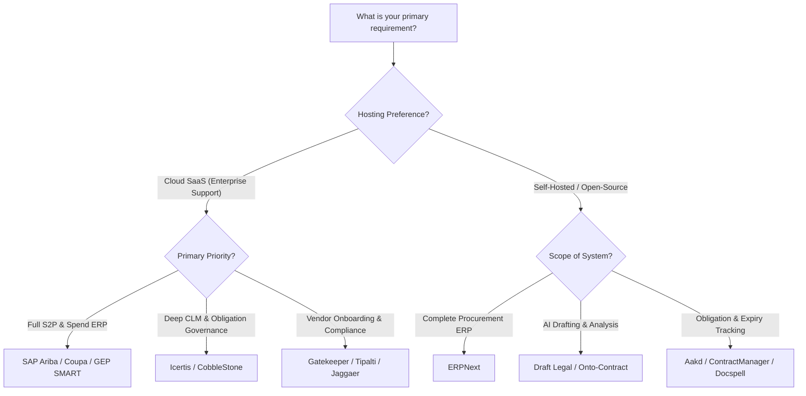

# Awesome Supplier Contract & Vendor Agreement Management 📑🤝

  

  
  
  
  
  
  
  

> 🌟 **A definitive, curated index of premier Supplier Contract and Vendor Agreement Management solutions** — comparing leading commercial enterprise Contract Lifecycle Management (CLM) / Source-to-Pay (S2P) suites alongside self-hosted open-source alternatives. Master your supplier contracts, third-party risk management (TPRM), post-signature milestone obligations, and procurement workflows.
> 
> 💡 *Star this repository to keep up-to-date with emerging tools and ecosystem shifts!* ⭐

---

## 🧭 Table of Contents

- [🌐 Sector Overview & Market Dynamics](#-sector-overview--market-dynamics)
- [🟦 SaaS / Hosted Platforms](#-saas--hosted-platforms)
  - [SaaS Solutions Comparison Matrix](#-saas-solutions-comparison-matrix)
  - [Detailed SaaS Profiles](#-detailed-saas-profiles)
- [🟩 Open-Source Software](#-open-source-software)
  - [Open-Source Solutions by Stars_Count](#-open-source-solutions-by-star-count)
  - [Detailed Open-Source Profiles](#-detailed-open-source-profiles)
- [📊 Full Comparison at a Glance](#-full-comparison-at-a-glance)
- [🎯 Choosing the Right Solution](#-choosing-the-right-solution)
- [💖 Support & Community](#-support--community)
- [📈 Star History](#-star-history)
- [🤝 Contributing](#-contributing)
- [📄 License](#-license)

---

## 🌐 Sector Overview & Market Dynamics

The global **Contract Lifecycle Management (CLM)** market is estimated at **$2.0B – $3.6B** (projected to exceed $8B–$11B by 2033–2035 at ~13–14% CAGR), while the broader **Vendor Management Software (VMS) & Procurement** market is valued at **$11.5B – $12.9B** with double-digit expansion driven by supply chain resilience and AI-powered automation. 

The sector is **moderately fragmented**: mega-cap ERP platforms (like SAP and Coupa) dominate Fortune 500 Source-to-Pay backbones, yet deep specialized CLM vendors (such as Icertis and Gatekeeper) capture significant enterprise share through superior domain-specific obligation tracking and AI extraction, preventing a total "winner-take-all" consolidation.

---

## 🟦 SaaS / Hosted Platforms

Commercial, cloud-hosted enterprise Supplier Contract and Vendor Agreement Management platforms. The table below is **sorted descending by company scale (market cap / valuation / revenue)**.

### 📋 SaaS Solutions Comparison Matrix

| Platform 🏢 | Company Scale (Valuation / Revenue) 📈 | Specific Starting Pricing 💳 | Free Tier / Free Trial Limits ⏱️ | Core Focus & Governance Scope 🎯 |
|---|---|---|---|---|
| [**SAP Ariba Contracts**](https://www.ariba.com/) | **~$265 Billion Market Cap** (SAP SE; ~$40B ARR) | **~$6,667 / month** ($80,000 / year baseline contract suite; module add-ons ~$1,500–$2,000/user/yr) | **No free tier**; 30-day guided sandbox access provided upon sales qualification & guided discovery demo | Enterprise S2P, ERP spend integration, and Joule generative contract AI agents |
| [**Tipalti**](https://tipalti.com/) | **$8.3 Billion Valuation** (~$200M+ ARR) | **$99 / month** (Starter plan; Advanced AP automation tiers start at $149–$249/month + transaction fees) | **No free tier & no self-service trial**; interactive sandbox demo environment provided upon demo request | Supplier onboarding master data, W-9/W-8 compliance, tax validations, and 26K global rules |
| [**Coupa Source-to-Contract**](https://www.coupa.com/) | **$8.0 Billion Valuation** (Acquired by Thoma Bravo; ~$818M revenue) | **~$4,167 / month** ($50,000 / year mid-market base tier; small business modules start ~$2,200/yr) | **No free tier & no public trial**; scheduled 14-day assisted pilot sandbox available post-enterprise scoping | Autonomous contract creation, Spend-Under-Management (SUM) governance, and supplier onboarding |
| [**Icertis Contract Intelligence**](https://www.icertis.com/) | **$5.0 Billion Valuation** (~$300M+ ARR) | **~$12,500 / month** ($150,000 / year base entry deployment, billed annually) | **No free tier & no self-service trial**; customized POC (Proof of Concept) sandbox environment available via sales inquiry | Enterprise CLM, deep post-signature obligation tracking, tariff exposure, and SAP/Coupa ERP cross-checks |
| [**Jaggaer**](https://www.jaggaer.com/) | **$3.0 Billion Valuation** (Acquired by Vista Equity Partners; ~$300M+ revenue) | **~$500 / month** (Baseline £4,600 / ~$6,000 / year for 5-user S2C pack on public frameworks; 2-year min.) | **No free tier**; 14-day guided proof-of-concept trial arranged strictly via procurement sales consultation | Technical supplier certification enforcement, contractor compliance, and self-service registration |
| [**GEP SMART**](https://www.gep.com/) | **$2.6 Billion Revenue** (GEP Worldwide enterprise scale) | **~$6,250 / month** ($75,000 / year starting tier for single-module sourcing/contract deployment) | **No free tier & no self-service trial**; guided sandbox evaluation arranged following enterprise scoping session | Unified procurement contract authoring, clause libraries, autonomous procurement PO feeds, and analytics |
| [**Ivalua**](https://www.ivalua.com/) | **$1.1 Billion Valuation** (~$150M–$200M ARR) | **~$12,500 / month** ($150,000 / year starting contract for baseline single-module deployment) | **No free tier & no public trial**; bespoke proof-of-value sandbox access supplied during formal enterprise RFPs | Connected Source-to-Contract (S2C), AI agents for intake routing, proposal scoring, and supplier profiles |
| [**CobbleStone Contract Insight**](https://www.cobblestonesoftware.com/) | **~$26.5 Million Revenue** (Bootstrapped / Private) | **$59 / user / month** (CobbleStone Express edition; Enterprise with VISDOM AI on custom quote) | **30-day full-featured free trial** available upon request, including repository access and demo e-signatures | Public sector & mid-market CLM, eProcurement, vendor scorecards, and InteliSign e-signature |
| [**Gatekeeper**](https://www.gatekeeperhq.com/) | **~$14.0 Million Revenue** (Privately held) | **$1,245 / month** (Essentials tier billed annually, covering up to 150 active contracts & suppliers) | **14-day sandbox trial** available via select cloud marketplace partner channels (e.g., Microsoft AppSource) | Unlimited user licensing, Lumin Extract AI ingestion, and deduplicated third-party vendor tracking |

---

### 🔍 Detailed SaaS Profiles

#### [Icertis Supplier Contract Management](https://www.icertis.com/) 🏛️
* **Type:** Enterprise CLM with dedicated supplier governance
* **Starting Price:** ~$12,500 / month ($150,000 / year billed annually)
* **Trial / Free Tier:** No free tier; custom POC sandbox available on sales qualification
* **Company Scale:** $5.0 Billion Valuation (~$300M+ ARR)
* **Capabilities:** Icertis provides deep Contract Lifecycle Management (CLM) engineered for procurement agreements. It standardizes supplier negotiations with approved terms, fallback positions, and procurement benchmarks while tracking supplier milestones, SLAs, and commercial commitments post-signature. AI-guided risk analysis inspects vendor exposure and tariff impacts across enterprise portfolios. Integrates directly into SAP Ariba, Coupa, and NetSuite to cross-reference invoices and purchase orders against active contract terms.
* **Best For:** Large enterprises governing mission-critical supplier agreements requiring strict obligation governance and automated ERP cross-referencing.

#### [SAP Ariba Contracts](https://www.ariba.com/) 🌐
* **Type:** Integrated enterprise contract management within SAP ecosystem
* **Starting Price:** ~$6,667 / month (~$80,000 / year base; per-user additions ~$1,500–$2,000/yr)
* **Trial / Free Tier:** No free tier; 30-day guided sandbox access provided upon enterprise discovery demo
* **Company Scale:** ~$265 Billion Market Cap (SAP SE; ~$40B ARR)
* **Capabilities:** Combines automation and AI agents via Joule to modernize procurement contract lifecycles. Features centralized contract workspaces, real-time spend and compliance tracking, and embedded SAP Ariba Contract Intelligence (powered by Icertis) for AI-driven clause assembly and redlining.
* **Best For:** SAP-centric organizations seeking native interoperability between sourcing, PO creation, and supplier management.

#### [Coupa Source-to-Contract](https://www.coupa.com/) 💼
* **Type:** Source-to-Contract (S2C) suite with AI-assisted contract authoring
* **Starting Price:** ~$4,167 / month ($50,000 / year base; entry modules start ~$2,200/yr)
* **Trial / Free Tier:** No free tier; 14-day assisted pilot sandbox available post-scoping
* **Company Scale:** $8.0 Billion Valuation (Acquired by Thoma Bravo; ~$818M revenue)
* **Capabilities:** Connects savings identification, bid requests, quotation evaluation, and contract generation into one workflow. AI automates contract creation and highlights non-standard clauses, instantly publishing executed contracts to procurement catalogs.
* **Best For:** Mid-market to enterprise procurement teams requiring contract authoring tightly linked to sourcing and supplier onboarding.

#### [Jaggaer](https://www.jaggaer.com/) 🏭
* **Type:** Supplier management, contractor compliance, and S2C governance
* **Starting Price:** ~$500 / month (Baseline £4,600 / ~$6,000 / year for 5-user S2C pack on public frameworks)
* **Trial / Free Tier:** No free tier; 14-day guided proof-of-concept arranged via consultation
* **Company Scale:** $3.0 Billion Valuation (Vista Equity Partners; ~$300M+ revenue)
* **Capabilities:** Manages extensive supplier directories with contractor compliance rules. Automates supplier suggestions by commodity, prevents duplicate registrations, and blocks unverified vendors lacking current certificates or required insurance.
* **Best For:** Manufacturing and asset-heavy organizations managing tens of thousands of technical contractors and suppliers.

#### [Gatekeeper](https://www.gatekeeperhq.com/) 🛡️
* **Type:** Vendor management and CLM with AI data extraction
* **Starting Price:** $1,245 / month (Essentials tier billed annually, includes up to 150 contracts & vendors)
* **Trial / Free Tier:** 14-day sandbox trial available through select cloud marketplace channels (e.g., Microsoft AppSource)
* **Company Scale:** ~$14.0 Million ARR (Privately held)
* **Capabilities:** Lumin Extract turns third-party vendor contracts into structured records in a single pass, pulling key milestones, values, and renewals. Third-Party Match Service automatically matches contracts to vendor master records, preventing duplicate entries. Includes unlimited user seats on all tiers.
* **Best For:** Teams wanting clean vendor master data and rapid AI ingestion without per-user licensing fees.

#### [Ivalua](https://www.ivalua.com/) 🤖
* **Type:** Source-to-Contract suite with specialized autonomous AI agents
* **Starting Price:** ~$12,500 / month ($150,000 / year starting base deployment)
* **Trial / Free Tier:** No free tier; bespoke proof-of-value sandbox access supplied during RFPs
* **Company Scale:** $1.1 Billion Valuation (~$150M–$200M ARR)
* **Capabilities:** Covers procurement from intake to execution with specialized AI agents. Intake agents route purchasing requests to appropriate workflows, while supplier profiles are autonomously updated with third-party intelligence.
* **Best For:** Global enterprises requiring end-to-end S2C capabilities with configurable workflow orchestration.

#### [Tipalti](https://tipalti.com/) 💳
* **Type:** Supplier onboarding, tax compliance, and payment governance
* **Starting Price:** $99 / month (Starter tier; Advanced AP automation tiers start at $149–$249/month)
* **Trial / Free Tier:** No free tier & no self-service trial; interactive test sandbox provided on demo request
* **Company Scale:** $8.3 Billion Valuation (~$200M+ ARR)
* **Capabilities:** Provides automated supplier self-service portals, payment selection, W-9/W-8 tax compliance collection, and fraud prevention through a rules engine with 26,000 global rules. Establishes the validated supplier data baseline needed for contract compliance.
* **Best For:** Finance and procurement teams wanting rigorous supplier onboarding, automated tax compliance, and global payment governance.

#### [CobbleStone Contract Insight](https://www.cobblestonesoftware.com/) 🏛️
* **Type:** CLM with integrated vendor management and eProcurement
* **Starting Price:** $59 / user / month (Express edition; Enterprise edition on custom quote)
* **Trial / Free Tier:** 30-day full-featured free trial available upon direct request
* **Company Scale:** ~$26.5 Million Revenue (Privately held)
* **Capabilities:** Provides contract drafting, approval workflows, obligation monitoring, VISDOM AI analysis, and e-signatures (InteliSign). Includes vendor rating cards, document versioning, and public sector compliance frameworks.
* **Best For:** Public sector bodies, higher education, and mid-sized enterprises seeking proven CLM functionality with low entry costs.

#### [GEP SMART](https://www.gep.com/) ⚡
* **Type:** Unified procurement, contract lifecycle, and spend management platform
* **Starting Price:** ~$6,250 / month ($75,000 / year starting tier for single-module deployment)
* **Trial / Free Tier:** No free tier; guided sandbox evaluation arranged following enterprise scoping session
* **Company Scale:** $2.6 Billion Revenue (GEP Worldwide scale)
* **Capabilities:** Pre-approved clause libraries, automated renewal alerts, spend-to-contract utilization analytics, and agentic AI capabilities that feed negotiated rates directly into purchase orders and catalog requisitions.
* **Best For:** Procurement departments wanting unified sourcing, contracting, and procure-to-pay automation on one platform.

---

## 🟩 Open-Source Software

Self-hosted, transparent, community-driven contract and vendor agreement management systems. 

Repositories are **sorted descending by GitHub_Stars_Count** and feature live social badges linking to their respective stargazers page.

### 🌟 Open-Source Solutions by Stars_Count

| Repository & Stars_Badge 📦 | GitHub_Stars ⭐ | Primary Tech Stack 💻 | License 📜 | Key Governance Strengths 🛡️ |
|---|---|---|---|---|
| [**frappe/erpnext**](https://github.com/frappe/erpnext)  | **41,000+** | Python / JavaScript / MariaDB | GPL-3.0 | Complete supplier lifecycle, purchase agreements, PO matching, and supplier scorecards |
| [**eikek/docspell**](https://github.com/eikek/docspell)  | **2,300+** | Scala / Elm / PostgreSQL | AGPL-3.0 | Automated machine-learning OCR classification for vendor bills, agreements, and contract metadata |
| [**sharptoolbox/Onto-Contract**](https://github.com/sharptoolbox/Onto-Contract)  | **49** | Python / Vue / Neo4j / LLMs | MIT | Ontology-driven AI-native contract management with relationship graph modeling and clause extraction |
| [**AniketTati/draft-legal**](https://github.com/AniketTati/draft-legal)  | **21** | TypeScript / Next.js / Python | Apache-2.0 | Self-hosted AI-native contract lifecycle management alternative to Ironclad; documents stay local |
| [**janrieke/contractmanager**](https://github.com/janrieke/contractmanager)  | **20** | Java / Jameica Platform | GPL-2.0 | Desktop contract management, cancellation deadlines, costs tracking, and recurring obligation alerts |
| [**edictum-ai/edictum-console**](https://github.com/edictum-ai/edictum-console)  | **18** | Go / TypeScript / React | Apache-2.0 | AI agent governance console featuring contract management, HITL approvals, and audit trails |
| [**DarkcoderSe/vms**](https://github.com/DarkcoderSe/vms)  | **16** | PHP (Laravel) / Electron / MySQL | MIT | Desktop-packaged vendor tracking, contract terms, purchase orders, and renewal reminders |
| [**aaked-app/aakd**](https://github.com/aaked-app/aakd)  | **12** | TypeScript / Docker / PostgreSQL / MinIO | Apache-2.0 | Post-signature obligation extraction, page-level evidence citation, and local Ollama AI support |
| [**Notanormaldev/Odoo_VendorBridge**](https://github.com/Notanormaldev/Odoo_VendorBridge)  | **4** | React 19 / Node / MongoDB / LangChain | MIT | AI vendor management ERP with multi-tier approval chains and automated risk scoring |
| [**ConductionNL/shillinq**](https://github.com/ConductionNL/shillinq)  | **1** | PHP / Nextcloud / OpenRegister | EUPL-1.2 | Nextcloud-integrated business suite covering procurement, vendor onboarding, and contract renewal workflows |

---

### 📖 Detailed Open-Source Profiles

#### [ERPNext](https://github.com/frappe/erpnext)  🏢
* **Tech Stack:** Python, Frappe Framework, JavaScript, MariaDB | **License:** GNU GPL-3.0
* **Overview:** While a full ERP, ERPNext provides one of the most mature open-source procurement, supplier quotation, and purchase contract management engines available. It tracks supplier master records, blanket vendor agreements, item-level pricing rules, milestone delivery obligations, and automated three-way matching against invoices and purchase orders.
* **Best For:** Teams wanting an enterprise-grade, battle-tested open-source platform managing complete procurement, purchasing agreements, and supplier accounts.

#### [Docspell](https://github.com/eikek/docspell)  🗄️
* **Tech Stack:** Scala, Elm, PostgreSQL, Apache Solr | **License:** AGPL-3.0
* **Overview:** A personal and small-business document organizer that specializes in automatic OCR, metadata tagging, and machine-learning classification. When ingested, vendor contracts and invoices are linked to specific organizations, extracting due dates, renewal terms, and payment obligations automatically.
* **Best For:** Small organizations wanting automated document repository ingestion, OCR indexing, and renewal notification tracking for vendor documents.

#### [Onto-Contract](https://github.com/sharptoolbox/Onto-Contract)  🧠
* **Tech Stack:** Python, Vue.js, Neo4j, LLM RAG | **License:** MIT
* **Overview:** An ontology-driven, AI-native contract management system. By structuring legal and supplier agreements into knowledge graphs, it automatically maps party relationships, extracted clauses, risk obligations, and cross-contract dependencies.
* **Best For:** Legal and procurement engineers building knowledge-graph-driven contract intelligence and obligation tracking.

#### [Draft Legal](https://github.com/AniketTati/draft-legal)  ✍️
* **Tech Stack:** TypeScript, Next.js, Python, Tailwind CSS | **License:** Apache-2.0
* **Overview:** Billed as an open-source alternative to Ironclad and Harvey. Designed to be self-hosted so sensitive agreements and vendor terms never leave corporate infrastructure. Includes AI-native clause drafting, redlining, and automated review agents.
* **Best For:** Organizations seeking a modern, AI-assisted contract review and drafting platform that runs completely on-premise or within a private cloud.

#### [ContractManager](https://github.com/janrieke/contractmanager)  📅
* **Tech Stack:** Java, Jameica Framework, H2 Database | **License:** GPL-2.0
* **Overview:** A desktop application designed specifically to track agreements, notice periods, cancellation dates, and recurring supplier payment obligations. Features automated warning thresholds before contract lock-ins renew.
* **Best For:** Individuals and small office administrators needing an offline, lightweight contract tracker focused on cancellation deadlines.

#### [Edictum Console](https://github.com/edictum-ai/edictum-console)  🛡️
* **Tech Stack:** Go, TypeScript, React | **License:** Apache-2.0
* **Overview:** A self-hostable operations console specifically for governing automated and agent-driven legal processes. Integrates contract review workflows, Human-in-the-Loop (HITL) approval gates, and tamper-proof audit trails.
* **Best For:** Engineering teams deploying autonomous AI agents that need rigid contractual boundaries and compliance sign-offs.

#### [SevenSquare VMS (DarkcoderSe/vms)](https://github.com/DarkcoderSe/vms)  🖥️
* **Tech Stack:** Laravel, Electron, MySQL | **License:** MIT
* **Overview:** A desktop-packaged vendor management system for managing suppliers, agreement dates, and purchase orders. Includes vendor contact records, terms tracking, and renewal alerting in a native desktop window.
* **Best For:** Teams wanting an offline or local desktop application for managing vendor lists and agreement expiry dates.

#### [Aakd](https://github.com/aaked-app/aakd)  🔍
* **Tech Stack:** TypeScript, Docker, PostgreSQL, MinIO | **License:** Apache-2.0
* **Overview:** A self-hostable contract lifecycle management platform dedicated to post-signature obligation review. Turns PDF/DOCX contracts into reviewed actions with page-level evidence, renewal notifications, audit trails, and an optional local Ollama LLM extraction layer.
* **Best For:** Teams wanting self-hosted, post-signature obligation tracking with source citation verification.

#### [VendorBridge AI](https://github.com/Notanormaldev/Odoo_VendorBridge)  🤖
* **Tech Stack:** React 19, Express 5, MongoDB, Redis, LangChain | **License:** MIT
* **Overview:** An AI-powered procurement and vendor management system featuring Google Gemini assistance, multi-level approval hierarchies, automated PDF invoice generation, and vendor performance risk scoring.
* **Best For:** Developers looking for a modern full-stack reference implementation of an AI-driven vendor scoring and procurement portal.

#### [Shillinq](https://github.com/ConductionNL/shillinq)  ☁️
* **Tech Stack:** PHP, Nextcloud, OpenRegister | **License:** EUPL-1.2
* **Overview:** An open-source business administration suite built for the Nextcloud ecosystem. Combines procurement workflows, supplier qualification questionnaires, and basic contract expiration tracking directly inside an existing Nextcloud instance.
* **Best For:** Teams running Nextcloud looking to centralize supplier qualification and contract renewal reminders without introducing a separate SaaS service.

---

## 📊 Full Comparison at a Glance

| Solution 🗂️ | Delivery Model 🚀 | Pricing / Star Rating ⭐ | Contract Drafting 📝 | Obligation & Milestone Tracking ⏰ | Supplier Master & TPRM 🛡️ | Best Fit Scenario 💡 |
|---|---|---|---|---|---|---|
| **SAP Ariba** | Cloud SaaS | From ~$6,667/mo ($80k/yr) | ✅ (Joule / Icertis) | ✅ Advanced | ✅ Comprehensive S2P | Global SAP-centric enterprises |
| **Tipalti** | Cloud SaaS | From $99/mo | ❌ (PO / Finance) | ⚠️ Payment milestones | ✅ Full Onboarding & Tax | High-volume cross-border vendor payments |
| **Coupa S2C** | Cloud SaaS | From ~$4,167/mo ($50k/yr) | ✅ AI Generation | ✅ Comprehensive | ✅ Integrated S2C | End-to-end sourcing and spend management |
| **Icertis** | Cloud SaaS | From ~$12,500/mo ($150k/yr) | ✅ Clause Library | ✅ AI Obligation Sync | ✅ Integrated TPRM | Complex enterprise supplier contracts |
| **Jaggaer** | Cloud SaaS | From ~$500/mo (£4,600/yr) | ⚠️ Template-based | ✅ Compliance alerts | ✅ Self-service onboarding | Heavy manufacturing & technical contractors |
| **GEP SMART** | Cloud SaaS | From ~$6,250/mo ($75k/yr) | ✅ Dynamic Authoring | ✅ AI Smart Alerts | ✅ Complete Supplier 360 | Procurement leaders standardizing S2P |
| **Ivalua** | Cloud SaaS | From ~$12,500/mo ($150k/yr) | ✅ Agent-assisted | ✅ Spend-to-terms tracking | ✅ Enriched supplier profiles | Complex multi-tier supply chains |
| **CobbleStone** | Cloud SaaS | From $59/user/mo | ✅ Document Authoring | ✅ VISDOM AI Tracking | ✅ Vendor Ratings | Public sector, education, and mid-market CLM |
| **Gatekeeper** | Cloud SaaS | From $1,245/mo | ⚠️ Ingestion focused | ✅ Renewal & Obligation | ✅ Deduplicated TPRM | Fast-growing teams needing unlimited users |
| **ERPNext** | Self-Hosted OS | 🌟 41,000+ GitHub_Stars | ⚠️ Template PO/Agreements | ✅ Milestone Delivery | ✅ Full ERP Supplier Ledger | Complete open-source procurement suite |
| **Docspell** | Self-Hosted OS | 🌟 2,300+ GitHub_Stars | ❌ Document store | ⚠️ Expiry date alerts | ⚠️ Contact categorization | Automated OCR document indexing & filing |
| **Onto-Contract**| Self-Hosted OS | 🌟 49 GitHub_Stars | ✅ Graph LLM Assisted | ✅ Knowledge Graph Alerts | ⚠️ Ontology relationships | AI-native contract relationship modeling |
| **Draft Legal** | Self-Hosted OS | 🌟 21 GitHub_Stars | ✅ AI Redlining & Review | ⚠️ Document status | ❌ (Contract centric) | Privacy-first local AI contract drafting |
| **ContractManager**| Desktop OS | 🌟 20 GitHub_Stars | ❌ (Record keeping) | ✅ Notice Period Warnings | ⚠️ Basic Vendor Records | Local desktop agreement deadline tracking |
| **Edictum Console**| Self-Hosted OS | 🌟 18 GitHub_Stars | ⚠️ Policy approval | ✅ Audit Trail Logging | ⚠️ Agent identity records | AI agent contractual boundary governance |
| **SevenSquare VMS**| Desktop OS | 🌟 16 GitHub_Stars | ⚠️ Agreement profiles | ✅ Renewal Warnings | ✅ Vendor Directory | Offline desktop vendor and PO tracking |
| **Aakd** | Self-Hosted OS | 🌟 12 GitHub_Stars | ❌ (Post-signature) | ✅ Page-Level Evidence | ⚠️ Reference links | Self-hosted post-signature obligation review |
| **VendorBridge AI**| Self-Hosted OS | 🌟 4 GitHub_Stars | ⚠️ PO / Invoicing | ⚠️ Fulfillment tracking | ✅ Risk scoring & profiles | Full-stack AI vendor ERP reference build |
| **Shillinq** | Nextcloud OS | 🌟 1 star | ⚠️ Basic templates | ✅ Nextcloud Calendar sync | ✅ Supplier questionnaires | Nextcloud-integrated contract management |

---

## 🎯 Choosing the Right Solution

---

## 💖 Support & Community

Thank you for exploring and utilizing this curated directory! If this guide helped you or your team evaluate supplier contract and vendor agreement management solutions, please consider supporting the project:

- ⭐ **Star this repository** to improve discoverability for others.
- 🍴 **Fork and share** it across your organization, legal ops networks, or developer circles.
- 💬 Join the conversation and connect with our community on [Discord](https://discord.gg/jc4xtF58Ve).
- ☕ **Buy a coffee & sponsor ongoing maintenance:** Support our open-source research and tooling efforts through the [GitHub Sponsors Dashboard](https://github.com/sponsors/ishandutta2007).

---

## 📈 Star History

---

## 🤝 Contributing

Contributions and recommendations are warmly welcomed! To suggest an addition or correction:

1. 🍴 **Fork the repository**
2. 🌿 **Create a descriptive feature branch** (`git checkout -b add-tool-name`)
3. 📝 **Add the tool** with exact starting pricing, free tier/trial limits, company valuation or Stars_Count badges
4. 🚀 **Submit a Pull Request** with a concise summary of why the solution fits the directory

Please ensure any suggested open-source repositories are active (commits or releases within the past 12 months) and properly licensed.

---

## 📄 License

This compilation is licensed under the [Creative Commons Zero v1.0 Universal (CC0-1.0)](https://creativecommons.org/publicdomain/zero/1.0/) Public Domain Dedication. Listed third-party platforms, logos, and projects remain the intellectual property and copyright of their respective owners.

---

  Built with ❤️ for the global procurement, legal operations, and open-source community. If this list proved valuable, please consider giving it a ⭐!

